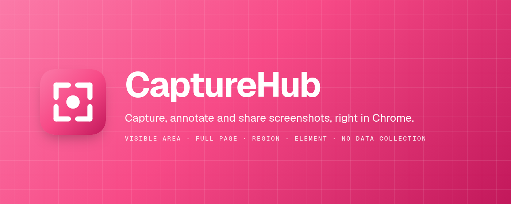
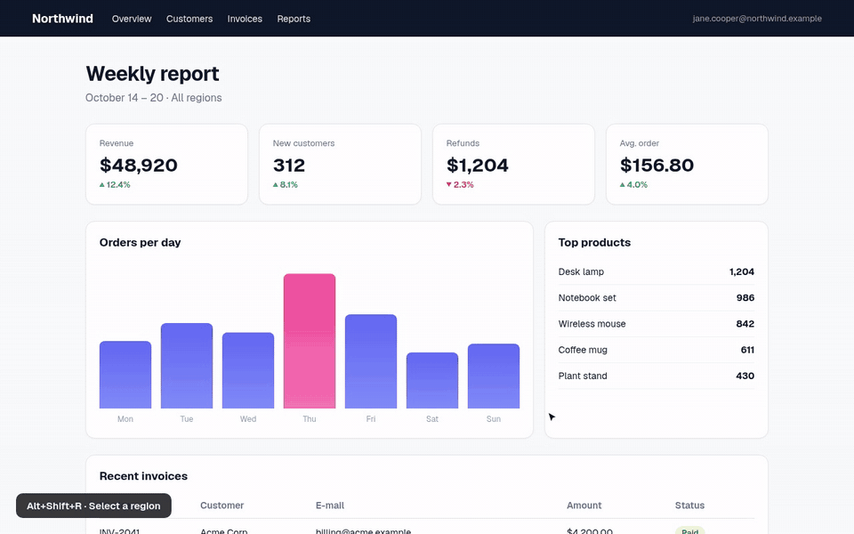
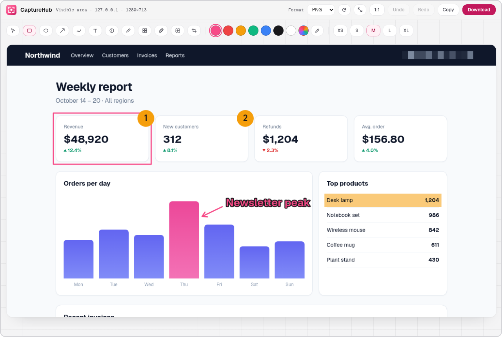
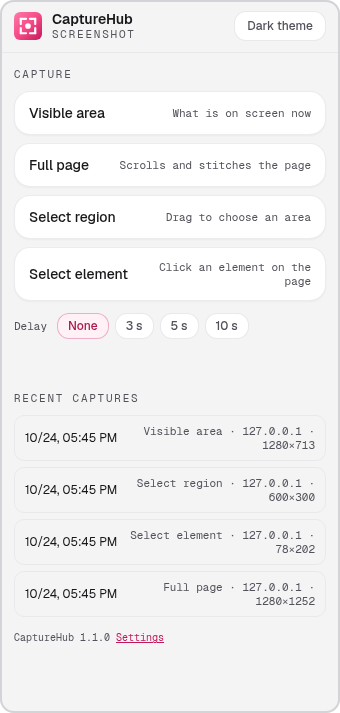
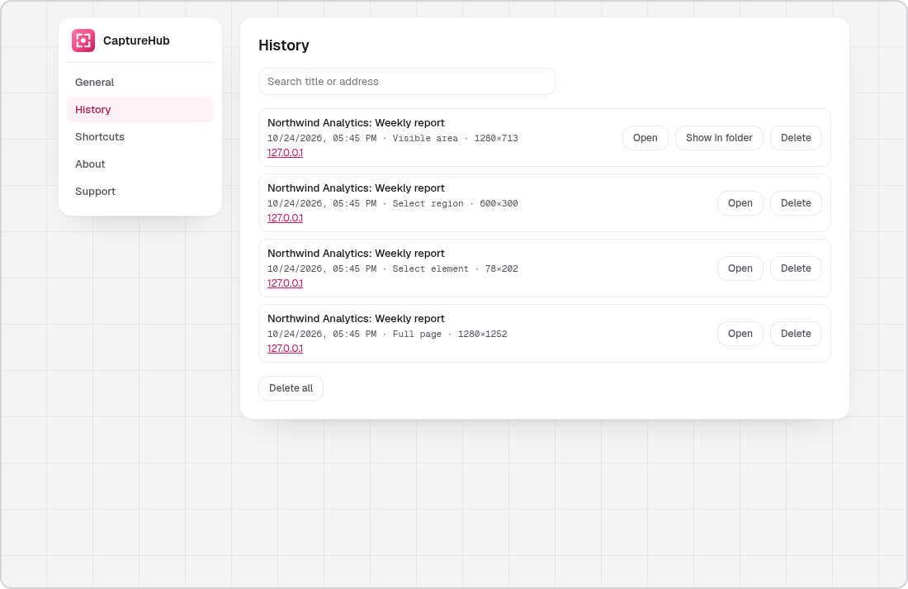
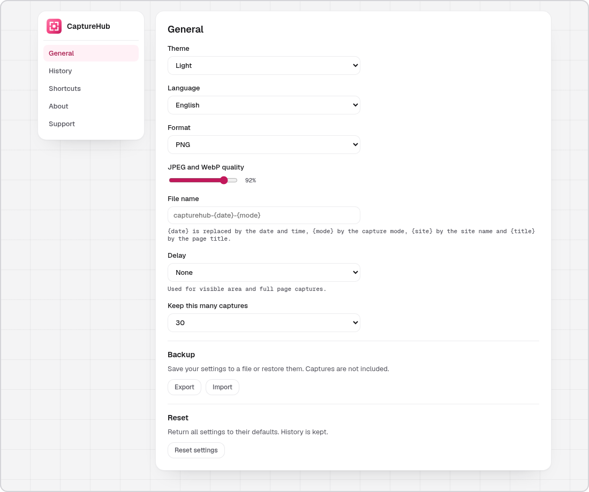
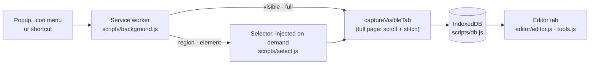

<p align="center">
  
</p>

<p align="center">
  <b>Capture, annotate and share screenshots, right in Chrome.</b><br>
  Visible area, full page, region, or a single element. An editor for arrows, text, numbers and blur. No data collection.
</p>

<p align="center">
  <a href="https://github.com/kilicberkay/CaptureHub/releases/latest"></a>
  <a href="https://github.com/kilicberkay/CaptureHub/actions/workflows/ci.yml"></a>
  <a href="LICENSE"></a>
  
  <a href="https://github.com/sponsors/kilicberkay"></a>
</p>

<p align="center">
  English · <a href="README.tr.md">Türkçe</a>
</p>

<p align="center">
  <a href="#install">Install</a> · <a href="#features">Features</a> · <a href="#screenshots">Screenshots</a> · <a href="docs/FAQ.md">FAQ</a> · <a href="#development">Development</a>
</p>

<p align="center">
  <a href="docs/videos/demo-en.mp4"></a><br>
  <sub><a href="docs/videos/demo-en.mp4">▶ Watch the full-quality video (MP4, 1280×800)</a></sub>
</p>

| Capture | Editor | Shortcuts | Data |
|---|---|---|---|
| Visible area, full page, region, element | Annotate, spot healing, content-aware fill, crop, rotate, resize | `Alt+Shift+V` `F` `R` `E` | None collected, nothing uploaded |

---

## Contents

- [What it does](#what-it-does)
- [Screenshots](#screenshots)
- [Features](#features)
- [Install](#install)
- [Use](#use)
- [Privacy and permissions](#privacy-and-permissions)
- [How it works](#how-it-works)
- [Development](#development)
- [Contributing and security](#contributing-and-security)
- [Support](#support)
- [License](#license)

## What it does

CaptureHub takes a screenshot of the page you are looking at, opens it in an editor, and lets you mark it up before
you copy it or save it. Pick what to capture: what is on screen, the whole page from top to bottom, an area you drag,
or a single element you click. Every capture is kept in a local history, together with the title and address of the
page it came from, so you can find it again.

## Screenshots

<table align="center" width="100%">
  <tr>
    <td align="center" colspan="2">
      <picture>
        <source media="(prefers-color-scheme: dark)" srcset="docs/images/dark/editor.png">
        
      </picture><br>
      <sub>Editor</sub>
    </td>
  </tr>
  <tr>
    <td align="center" width="34%">
      <picture>
        <source media="(prefers-color-scheme: dark)" srcset="docs/images/dark/popup.png">
        
      </picture><br>
      <sub>Toolbar popup</sub>
    </td>
    <td align="center" width="66%">
      <picture>
        <source media="(prefers-color-scheme: dark)" srcset="docs/images/dark/settings-history.png">
        
      </picture><br>
      <sub>History</sub>
      <br><br>
      <picture>
        <source media="(prefers-color-scheme: dark)" srcset="docs/images/dark/settings-general.png">
        
      </picture><br>
      <sub>Settings</sub>
    </td>
  </tr>
</table>

## Features

### Four ways to capture

- **Visible area**: what is on screen right now.
- **Full page**: scrolls the page and stitches the pieces together. Fixed and sticky headers appear only at the top
  and footers only at the bottom, instead of repeating on every screen. Pages that scroll inside a single container
  (many web apps) are captured too. Very long pages are cut at 16,000 pixels, and the editor tells you when that happens.
- **Region**: drag a rectangle; its size is shown while you drag. Esc cancels.
- **Element**: move the mouse over the page and click the highlighted element to capture exactly its box.

An optional **delay** (3, 5, or 10 seconds, counted down on the toolbar icon) gives you time to open a menu or a
tooltip before a visible area or full page capture.

### Editor

| Tool | Key | What it does |
|---|---|---|
| Select | `V` | Select, move, and resize marks with their handles. Arrow keys nudge (Shift: 10 px), Delete removes. |
| Box | `R` | Rectangle outline |
| Ellipse | `E` | Ellipse outline; hold Shift for a circle |
| Arrow | `A` | Arrow from the press point to the release point |
| Pen | `P` | Freehand line |
| Text | `T` | Click, type, press Enter. The text gets a contrasting outline so it reads on any background. |
| Number | `N` | Numbered markers (1, 2, 3 …) for step-by-step guides |
| Highlight | `H` | Marker-pen highlight that keeps the text under it readable |
| Pixelate | `B` | Hides e-mail addresses, names, and numbers under coarse pixels |
| Spot healing | `J` | Brush over text, an icon, or the cursor; when you release, the area is rebuilt from its surroundings |
| Content-aware fill | `F` | Drag a rectangle; its content is replaced from its surroundings |
| Crop | `C` | Drag an area, then **Apply crop** |

- **Spot healing and content-aware fill** rebuild the area from the pixels around it. They are made for screenshots:
  flat backgrounds, gradients, and interface surfaces come out clean. On photographic texture the result is smooth
  rather than textured. Each brush stroke is filled when you release it, so cover the whole spot in one stroke.
- **Colors**: seven presets, a custom color picker, and an **eyedropper** (`I`) that picks a color from anywhere on
  the screen. **Sizes**: XS, S, M, L, XL (also the brush size). Both apply to the selected mark too, and the last
  choice is remembered.
- **Rotate 90°** and **resize** (the aspect ratio is kept) are in the top bar. Marks rotate and scale with the image.
- **Undo and redo** every change, including crop (`Ctrl+Z`, `Ctrl+Shift+Z`).
- **1:1** shows the image at its real size.
- **Copy** puts a PNG on the clipboard. **Download** (`Ctrl+S`) saves PNG, JPEG, or WebP with your file name template.

### History

The last 10, 30, or 100 captures (your choice) are kept on your device. The settings page lists them with the page
title, site, mode, size, and time; you can search them, open one in the editor again, show the downloaded file in
its folder, or delete them. The toolbar popup shows the most recent ones.

### Settings

- **General**: theme (light, dark, or follow the system), interface language, default format and JPEG/WebP quality,
  file name template (`{date}`, `{mode}`), delay, history size, settings backup (export to and import from a JSON
  file), and reset to defaults.
- **History**: see above.
- **Shortcuts**: the shortcuts Chrome has assigned right now, and a button to change them.
- **About** and **Support**.

Theme changes apply at once to every open CaptureHub page.

### Fifteen languages

English, Türkçe, Deutsch, Español, Français, हिन्दी, Bahasa Indonesia, 日本語, Português (Brasil), Русский, العربية,
বাংলা, اردو, Tiếng Việt, 简体中文. The interface follows the browser language unless you choose one. Arabic and Urdu
are laid out right to left.

## Install

### From a release (recommended)

1. Download `capturehub-<version>.zip` from the [latest release](https://github.com/kilicberkay/CaptureHub/releases/latest)
   and unpack it.
2. Open `chrome://extensions` and turn on **Developer mode**.
3. Click **Load unpacked** and select the unpacked folder (the one that contains `manifest.json`).
4. Pin CaptureHub to the toolbar and press `Alt+Shift+R` on any page.

CaptureHub is not on the Chrome Web Store yet. The release page always has the newest package and its SHA-256 checksum.

### From source

Clone the repository and load the `extension/` folder with **Load unpacked**, as above.

Requires Chrome 116 or newer, or another Chromium-based browser that supports Manifest V3.

## Use

| Action | Shortcut | Popup or menu |
|---|---|---|
| Capture the visible area | `Alt+Shift+V` | Popup → *Visible area*, or right-click the toolbar icon |
| Capture the full page | `Alt+Shift+F` | Popup → *Full page*, or right-click the toolbar icon |
| Select a region | `Alt+Shift+R` | Popup → *Select region*, or right-click the toolbar icon |
| Select an element | `Alt+Shift+E` | Popup → *Select element*, or right-click the toolbar icon |
| Open the history or the settings | none | Right-click the toolbar icon → *History* or *Settings* |

On macOS the shortcuts are `Option+Shift+…`. Chrome assigns them only when the extension is installed and no other
extension uses them; check or change them at `chrome://extensions/shortcuts` (or **Settings → Shortcuts**).

Chrome does not allow capturing its own pages (`chrome://`, the Chrome Web Store, other extensions).

## Privacy and permissions

- **No data collection.** No analytics, telemetry, accounts, or servers. CaptureHub makes no network requests.
- **Captures stay local**, in the extension's IndexedDB, with the address and title of their page. Settings stay in
  `chrome.storage.local`. Removing the extension deletes both.
- **Minimal permissions**, and no access to all sites:

| Permission | Why |
|---|---|
| `activeTab` | The tab you are capturing, only after you click the icon, use its menu, or press a shortcut |
| `scripting` | Measures and scrolls the page for full page captures and shows the region and element selector |
| `storage` | Settings and the list of captures |
| `contextMenus` | The capture modes, History, and Settings in the toolbar icon's right-click menu |
| `downloads` | Saves downloads through Chrome's download manager and shows a downloaded file in its folder |

Full policy: [PRIVACY.md](PRIVACY.md).

## How it works



The design is described in [docs/ARCHITECTURE.md](docs/ARCHITECTURE.md).

## Development

**Requirements:** Node.js 20 or newer. The extension itself has no build step and no runtime dependencies; npm is
used only for scripts. There are no npm dependencies to install.

```bash
npm test              # every check, including the browser tests (needs Chromium)
npm run test:quick    # every check except the browser tests
npm run check         # syntax check of every JavaScript file
npm run build         # dist/capturehub-<version>.zip
npm run images        # README images and store images (needs Chromium)
npm run demo          # demo video and GIF, English and Turkish (needs Chromium and ffmpeg)
```

The browser tests use Chromium from `CHROME_BIN`, from `PLAYWRIGHT_BROWSERS_PATH`, or from the default Playwright
cache (`npx playwright@1.56.1 install chromium`). Branded Google Chrome 137 and newer ignores `--load-extension`, so
it is not used. Without a browser the tests are skipped.

<details>
<summary><b>Project layout</b></summary>

```
CaptureHub/
├── extension/           The extension itself; this folder is what gets packaged
│   ├── manifest.json    Manifest V3: name, permissions, shortcuts
│   ├── _locales/        Localized name, description, shortcut and menu texts (15 languages)
│   ├── scripts/         Service worker, selector, geometry, IndexedDB store
│   ├── editor/          Editor page: drawing and interaction
│   ├── popup/           Toolbar popup
│   ├── options/         Settings page
│   ├── shared/          Translations, settings model, theme, shared styles
│   ├── fonts/           Geist and Geist Mono (SIL OFL 1.1)
│   └── icons/           Toolbar and store icons (vector source: logo.svg)
├── tests/               Unit tests (tests/unit) and browser tests (tests/e2e)
├── tools/               Syntax check, test runner, zip build, image and video tools
├── store/               Chrome Web Store listing text and store images
├── docs/                Architecture, FAQ, translation guide, third-party notices, README images and videos
├── .github/             CI and release workflows, templates, contributing guide, code of conduct, security policy
├── README.md            English README (README.tr.md is the Turkish one)
├── CHANGELOG.md         Release history
├── PRIVACY.md           Privacy policy
├── LICENSE              MIT license
└── AGENTS.md            Notes for AI coding agents working on this repository
```

</details>

## Documentation

- [FAQ](docs/FAQ.md): restricted pages, shortcuts, long pages, storage, permissions.
- [Architecture](docs/ARCHITECTURE.md): how the pieces fit together.
- [Translating](docs/TRANSLATING.md): how to improve or add translations.

## Contributing and security

- Contributions are welcome. Start with [CONTRIBUTING.md](.github/CONTRIBUTING.md) and follow the [Code of Conduct](.github/CODE_OF_CONDUCT.md).
- Report security problems privately, through the **Security** tab (*Report a vulnerability*). See [SECURITY.md](.github/SECURITY.md).

## Support

CaptureHub is free and open source. If it saves you time, you can support its development on
[GitHub Sponsors](https://github.com/sponsors/kilicberkay), or give the repository a star. Support is never required.

## License

[MIT](LICENSE) © 2026 Berkay Kılıç. Third-party notices, including the Geist font (SIL OFL 1.1), are in
[THIRD_PARTY_NOTICES.md](docs/THIRD_PARTY_NOTICES.md).
