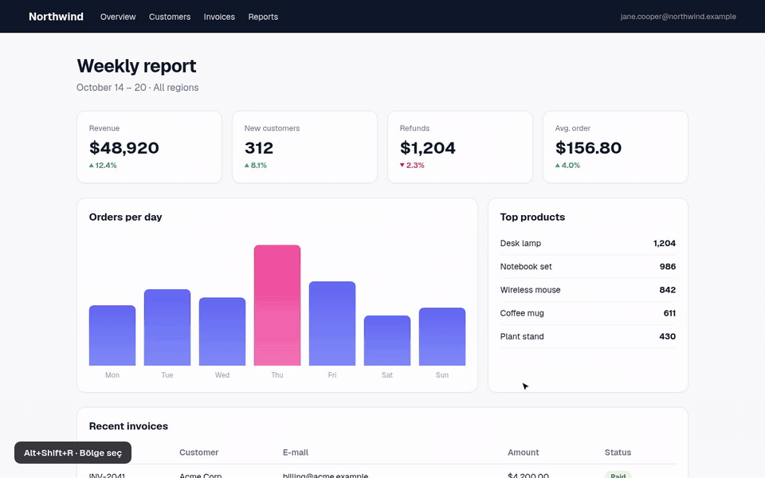
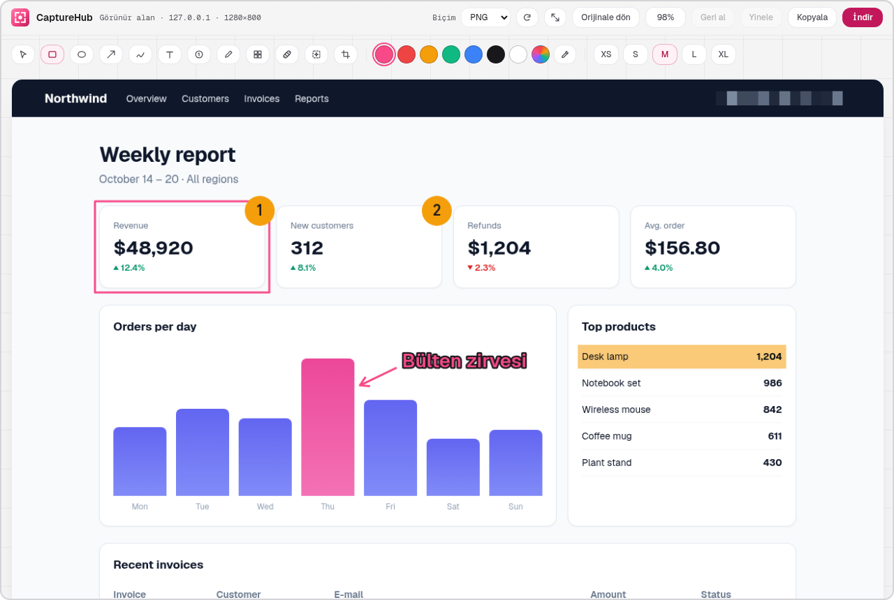
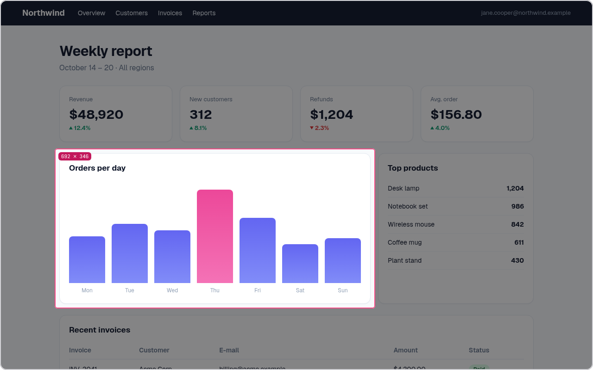
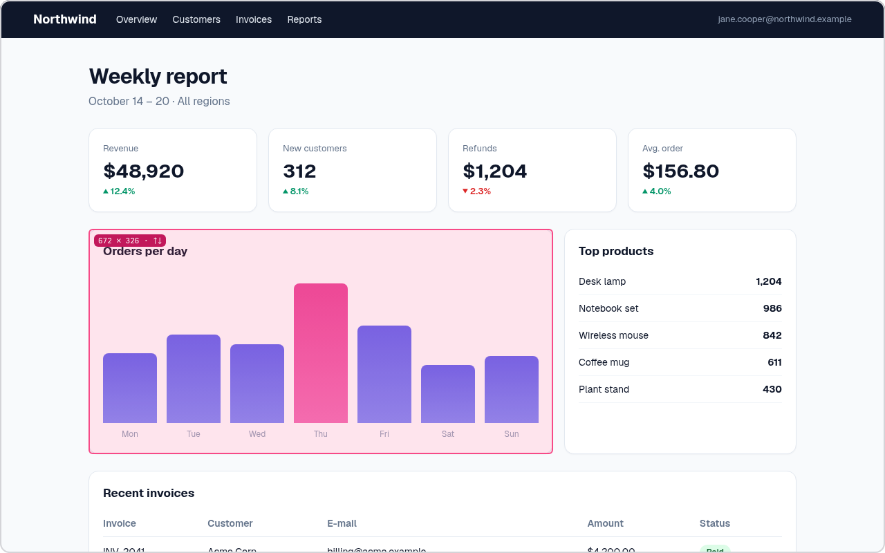
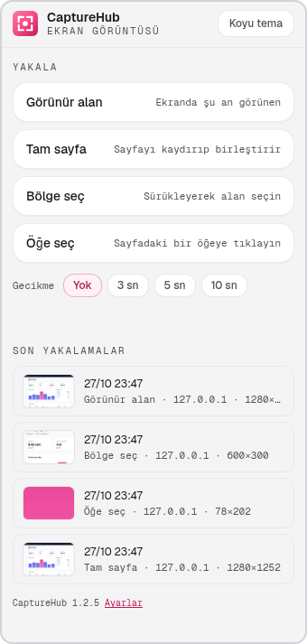
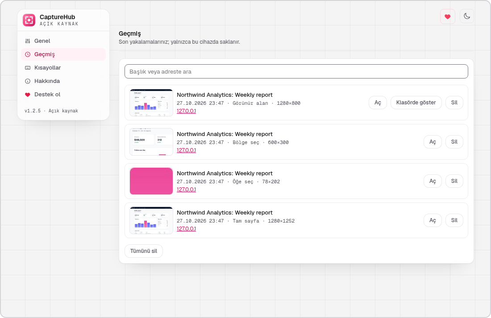
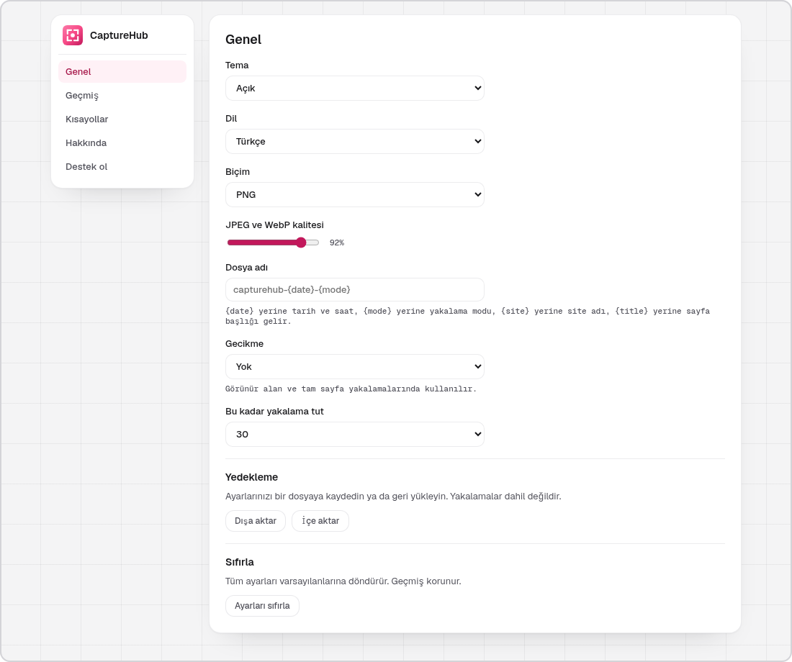
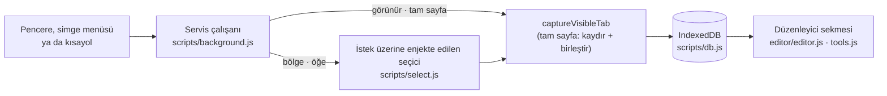

<p align="center">
  
</p>

<p align="center">
  <b>Ekran görüntüsünü Chrome'un içinde al, işaretle ve paylaş.</b><br>
  Görünür alan, tam sayfa, bölge ya da tek bir öğe. Ok, metin, numara ve bulanıklaştırma için düzenleyici. Veri toplanmaz.
</p>

<p align="center">
  <a href="https://chromewebstore.google.com/detail/capturehub/bnphimglccgfinadjbhkbjababninnfb"></a>
  <a href="https://github.com/kilicberkay/CaptureHub/releases/latest"></a>
  <a href="https://github.com/kilicberkay/CaptureHub/actions/workflows/ci.yml"></a>
  <a href="LICENSE"></a>
  
  <a href="https://github.com/sponsors/kilicberkay"></a>
</p>

<p align="center">
  <a href="README.md">English</a> · Türkçe
</p>

<p align="center">
  <a href="#kurulum">Kurulum</a> · <a href="#özellikler">Özellikler</a> · <a href="#ekran-görüntüleri">Ekran görüntüleri</a> · <a href="docs/FAQ.md">SSS (İngilizce)</a> · <a href="#geliştirme">Geliştirme</a>
</p>

<p align="center">
  <a href="docs/videos/demo-tr.mp4"></a><br>
  <sub><a href="docs/videos/demo-tr.mp4">▶ Tam kalite videoyu izleyin (MP4, 1280×800)</a></sub>
</p>

| Yakalama | Düzenleyici | Kısayollar | Veri |
|---|---|---|---|
| Görünür alan, tam sayfa, bölge, öğe | İşaretleme, leke iyileştirme, içeriğe duyarlı doldurma, kırpma, döndürme, boyutlandırma | `Alt+Shift+V` `F` `R` `E` | Toplanmaz, hiçbir şey yüklenmez |

---

## İçindekiler

- [Ne yapar](#ne-yapar)
- [Ekran görüntüleri](#ekran-görüntüleri)
- [Özellikler](#özellikler)
- [Kurulum](#kurulum)
- [Kullanım](#kullanım)
- [Gizlilik ve izinler](#gizlilik-ve-izinler)
- [Nasıl çalışır](#nasıl-çalışır)
- [Geliştirme](#geliştirme)
- [Katkı ve güvenlik](#katkı-ve-güvenlik)
- [Destek](#destek)
- [Lisans](#lisans)

## Ne yapar

CaptureHub baktığınız sayfanın ekran görüntüsünü alır, düzenleyicide açar ve kopyalamadan ya da kaydetmeden önce
üzerine işaret koymanızı sağlar. Neyin yakalanacağını siz seçersiniz: ekranda görünen, sayfanın baştan sona tamamı,
sürükleyerek seçtiğiniz bir alan ya da tıkladığınız tek bir öğe. Her yakalama, geldiği sayfanın başlığı ve adresiyle
birlikte yerel geçmişte tutulur; aradığınızı kolayca bulursunuz.

## Ekran görüntüleri

<table align="center" width="100%">
  <tr>
    <td align="center" colspan="2">
      <picture>
        <source media="(prefers-color-scheme: dark)" srcset="docs/images/tr/dark/editor.png">
        
      </picture><br>
      <sub>Düzenleyici</sub>
    </td>
  </tr>
  <tr>
    <td align="center" width="50%">
      <picture>
        <source media="(prefers-color-scheme: dark)" srcset="docs/images/tr/dark/region.png">
        
      </picture><br>
      <sub>Bölge yakalama</sub>
    </td>
    <td align="center" width="50%">
      <picture>
        <source media="(prefers-color-scheme: dark)" srcset="docs/images/tr/dark/element.png">
        
      </picture><br>
      <sub>Öğe yakalama</sub>
    </td>
  </tr>
  <tr>
    <td align="center" width="34%">
      <picture>
        <source media="(prefers-color-scheme: dark)" srcset="docs/images/tr/dark/popup.png">
        
      </picture><br>
      <sub>Araç çubuğu penceresi</sub>
    </td>
    <td align="center" width="66%">
      <picture>
        <source media="(prefers-color-scheme: dark)" srcset="docs/images/tr/dark/settings-history.png">
        
      </picture><br>
      <sub>Geçmiş</sub>
      <br><br>
      <picture>
        <source media="(prefers-color-scheme: dark)" srcset="docs/images/tr/dark/settings-general.png">
        
      </picture><br>
      <sub>Ayarlar</sub>
    </td>
  </tr>
</table>

## Özellikler

### Dört yakalama yolu

- **Görünür alan**: ekranda şu an görünen.
- **Tam sayfa**: sayfayı kaydırır ve parçaları birleştirir. Sabit ve yapışkan başlıklar yalnız en üstte, alt barlar
  yalnız en altta görünür; her ekranda tekrar etmez. Tek bir kapsayıcı içinde kayan sayfalar (birçok web uygulaması)
  da yakalanır. Tembel yüklenen görseller yakalamadan önce yüklenir. Çok uzun sayfalar 32.000 pikselde (çok geniş görüntülerde daha
  az) kesilir; düzenleyici bunu bildirir.
- **Bölge**: bir dikdörtgen sürükleyin; boyutu sürüklerken görünür. İmleci üst ya da alt kenarda tutarsanız sayfa kayar
  ve bölge ekrandan uzun olabilir. Esc iptal eder.
- **Öğe**: fareyi sayfada gezdirin, vurgulanan öğeye tıklayın; tam olarak o öğenin kutusu yakalanır. ↑ üst öğeyi seçer,
  ↓ geri iner, Enter yakalar. Ekrandan uzun öğeler de tamamıyla yakalanır.

İsteğe bağlı **gecikme** (3, 5 ya da 10 saniye, araç çubuğu simgesinde geri sayılır), görünür alan ve tam sayfa
yakalamasından önce bir menüyü ya da ipucunu açmanız için zaman tanır.

### Düzenleyici

| Araç | Tuş | Ne yapar |
|---|---|---|
| Seç | `V` | İşaretleri seçer, taşır ve tutamaçlarıyla boyutlandırır. Ok tuşları kaydırır (Shift: 10 px), Delete siler. |
| Kutu | `R` | Dikdörtgen çerçeve |
| Elips | `E` | Elips çerçeve; Shift ile tam daire |
| Ok | `A` | Basılan noktadan bırakılan noktaya ok |
| Kalem | `P` | Serbest çizgi |
| Metin | `T` | Tıklayın, yazın, Enter'a basın. Metnin karşıt renkli kenarlığı her zeminde okunmasını sağlar. |
| Numara | `N` | Adım adım anlatımlar için numaralı işaretler (1, 2, 3 …) |
| Vurgu | `H` | Altındaki metni okunur bırakan fosforlu kalem |
| Bulanıklaştır | `B` | E-posta, ad ve numaraları iri piksellerin altına gizler |
| Leke iyileştirme | `J` | Yazının, simgenin ya da imlecin üstünden fırçayla geçin; bırakınca alan çevresinden yeniden oluşturulur |
| İçeriğe duyarlı doldurma | `F` | Bir dikdörtgen sürükleyin; içi çevresinden doldurulur |
| Kırp | `C` | Bir alan sürükleyin, ardından **Kırpmayı uygula** |

- **Leke iyileştirme ve içeriğe duyarlı doldurma** alanı çevresinden yeniden oluşturur. Düz zemin, degrade ve arayüz
  yüzeylerinde alan yumuşak biçimde doldurulur; fotoğraf ve desenlerde çevreden uygun yamalar kopyalanır, doku sürer.
  Her fırça darbesi bırakılınca doldurulur; lekenin tamamını tek darbede örtün.
- **Renkler**: yedi hazır renk, özel renk seçici ve ekranın herhangi bir yerinden renk alan **damlalık** (`I`).
  **Boyutlar**: XS, S, M, L, XL (fırça boyutu da). İkisi de seçili işarete de uygulanır; son seçim hatırlanır.
- Üst çubukta **90° döndür** ve **boyutlandır** (oran korunur). İşaretler görüntüyle birlikte döner ve ölçeklenir.
- Kırpma dahil her değişiklik **geri alınır ve yinelenir** (`Ctrl+Z`, `Ctrl+Shift+Z`).
- **Metin** sonradan düzenlenebilir: üstüne çift tıklayın ya da Metin aracıyla tıklayın. Shift+Enter yeni satır açar.
- **Yakınlaştırma** %25–%400: Ctrl+tekerlek, + ve −, 0 sığdırır, 1 %100. Yakınlaştırma düğmesi oranı gösterir.
- **Kopyala** (`Ctrl+C`) panoya PNG koyar. **İndir** (`Ctrl+S`) dosya adı şablonunuzla PNG, JPEG ya da WebP kaydeder.
- **Düzenlemeler otomatik kaydedilir.** Geçmişten açtığınız yakalama bıraktığınız gibi gelir; **Orijinale dön**
  düzenlemeleri kaldırır. Özgün yakalama her zaman saklanır.

### Geçmiş

Son 10, 30 ya da 100 yakalama (seçiminize göre) cihazınızda tutulur. Ayarlar sayfası bunları küçük resim, sayfa
başlığı, site, mod, boyut ve zamanla listeler; arayabilir, düzenleyicide yeniden açabilir, indirilen dosyayı klasöründe
gösterebilir ya da silebilirsiniz. Araç çubuğu penceresi en yenilerini gösterir.

### Ayarlar

- **Genel**: tema (açık, koyu ya da sistemi izle), arayüz dili, varsayılan biçim ve JPEG/WebP kalitesi, dosya adı
  şablonu (`{date}`, `{mode}`, `{site}`, `{title}`), gecikme, geçmiş boyutu, ayar yedeği (JSON dosyasına dışa aktarma ve içe aktarma) ve
  varsayılanlara sıfırlama.
- **Geçmiş**: yukarıya bakın.
- **Kısayollar**: Chrome'un şu an atadığı kısayollar ve değiştirme düğmesi.
- **Hakkında** ve **Destek ol**.

Tema değişikliği açık olan tüm CaptureHub sayfalarına anında uygulanır.

### On beş dil

English, Türkçe, Deutsch, Español, Français, हिन्दी, Bahasa Indonesia, 日本語, Português (Brasil), Русский, العربية,
বাংলা, اردو, Tiếng Việt, 简体中文. Siz seçmedikçe arayüz tarayıcının dilini izler. Arapça ve Urduca sağdan sola dizilir.

## Kurulum

### Chrome Web Store (önerilen)

**[CaptureHub'ı Chrome'a ekleyin](https://chromewebstore.google.com/detail/capturehub/bnphimglccgfinadjbhkbjababninnfb)**

Mağaza güncellemeleri Google incelemesinden geçtiği için mağazadaki sürüm [son sürümün](https://github.com/kilicberkay/CaptureHub/releases/latest) gerisinde kalabilir. En yeni paket her zaman sürüm sayfasındadır.

### Sürüm paketinden

1. [Son sürümden](https://github.com/kilicberkay/CaptureHub/releases/latest) `capturehub-<sürüm>.zip` dosyasını indirip açın.
2. `chrome://extensions` sayfasını açın ve **Geliştirici modu**nu etkinleştirin.
3. **Paketlenmemiş öğe yükle**'ye tıklayın ve açtığınız klasörü (içinde `manifest.json` olan) seçin.
4. CaptureHub'ı araç çubuğuna sabitleyin ve herhangi bir sayfada `Alt+Shift+R`'ye basın.

### Kaynaktan

Depoyu klonlayın ve yukarıdaki gibi **Paketlenmemiş öğe yükle** ile `extension/` klasörünü seçin.

Chrome 116 ya da daha yenisi veya Manifest V3 destekleyen başka bir Chromium tabanlı tarayıcı gerekir.

## Kullanım

| İşlem | Kısayol | Pencere ya da menü |
|---|---|---|
| Görünür alanı yakala | `Alt+Shift+V` | Pencere → *Görünür alan* ya da simgeye sağ tık |
| Tam sayfayı yakala | `Alt+Shift+F` | Pencere → *Tam sayfa* ya da simgeye sağ tık |
| Bölge seç | `Alt+Shift+R` | Pencere → *Bölge seç* ya da simgeye sağ tık |
| Öğe seç | `Alt+Shift+E` | Pencere → *Öğe seç* ya da simgeye sağ tık |
| Geçmişi ya da ayarları aç | yok | Simgeye sağ tık → *Geçmiş* ya da *Ayarlar* |

macOS'te kısayollar `Option+Shift+…` şeklindedir. Chrome bunları yalnızca uzantı kurulurken ve başka bir uzantı
kullanmıyorsa atar; `chrome://extensions/shortcuts` adresinden (ya da **Ayarlar → Kısayollar**) denetleyip değiştirebilirsiniz.

Chrome kendi sayfalarının (`chrome://`, Chrome Web Store, diğer uzantılar) yakalanmasına izin vermez.

## Gizlilik ve izinler

- **Veri toplanmaz.** Analitik, telemetri, hesap ya da sunucu yok. CaptureHub hiçbir ağ isteği yapmaz.
- **Yakalamalar yerelde kalır**: uzantının IndexedDB deposunda, sayfalarının adresi ve başlığıyla. Ayarlar
  `chrome.storage.local` içindedir. Uzantıyı kaldırmak ikisini de siler.
- **En az izin**; tüm sitelere erişim yok:

| İzin | Neden |
|---|---|
| `activeTab` | Yalnızca simgeye tıkladığınızda, menüsünü kullandığınızda ya da kısayola bastığınızda, yakaladığınız sekme |
| `scripting` | Tam sayfa için sayfayı ölçüp kaydırır; bölge ve öğe seçiciyi gösterir |
| `storage` | Ayarlar ve yakalama listesi |
| `contextMenus` | Simgenin sağ tık menüsündeki yakalama modları, Geçmiş ve Ayarlar |
| `downloads` | İndirmeleri Chrome'un indirme yöneticisiyle kaydeder ve indirilen dosyayı klasöründe gösterir |

Politikanın tamamı: [PRIVACY.md](PRIVACY.md) (İngilizce).

## Nasıl çalışır



Tasarım [docs/ARCHITECTURE.md](docs/ARCHITECTURE.md) dosyasında anlatılır (İngilizce).

## Geliştirme

**Gereksinim:** Node.js 20 ya da daha yenisi. Uzantının derleme adımı ve çalışma zamanı bağımlılığı yoktur; npm
yalnızca betikler için kullanılır, kurulacak npm paketi yoktur.

```bash
npm test              # tarayıcı testleri dahil tüm denetimler (Chromium gerekir)
npm run test:quick    # tarayıcı testleri hariç tüm denetimler
npm run check         # tüm JavaScript dosyalarında sözdizimi denetimi
npm run build         # dist/capturehub-<sürüm>.zip
npm run images        # README ve mağaza görselleri (Chromium gerekir)
npm run demo          # tanıtım videosu ve GIF, İngilizce ve Türkçe (Chromium ve ffmpeg gerekir)
```

Tarayıcı testleri Chromium'u `CHROME_BIN`, `PLAYWRIGHT_BROWSERS_PATH` ya da varsayılan Playwright önbelleğinden
(`npx playwright@1.56.1 install chromium`) alır. Markalı Google Chrome 137 ve sonrası `--load-extension` bayrağını
yok saydığı için kullanılmaz. Tarayıcı yoksa testler atlanır.

## Katkı ve güvenlik

- Katkılara açığız. [CONTRIBUTING.md](.github/CONTRIBUTING.md) ile başlayın ve [Davranış Kuralları](.github/CODE_OF_CONDUCT.md)'na uyun.
- Güvenlik sorunlarını **Security** sekmesinden (*Report a vulnerability*) gizli olarak bildirin. Bkz. [SECURITY.md](.github/SECURITY.md).

## Destek

CaptureHub ücretsiz ve açık kaynaklıdır. İşinizi kolaylaştırıyorsa geliştirilmesini
[GitHub Sponsors](https://github.com/sponsors/kilicberkay) üzerinden destekleyebilir ya da depoya yıldız
verebilirsiniz. Destek hiçbir zaman zorunlu değildir.

## Lisans

[MIT](LICENSE) © 2026 Berkay Kılıç. Geist yazı tipi (SIL OFL 1.1) dahil üçüncü taraf bildirimleri
[THIRD_PARTY_NOTICES.md](docs/THIRD_PARTY_NOTICES.md) dosyasındadır.
