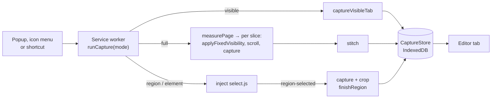

# Architecture

CaptureHub is a Manifest V3 Chrome extension. Its runtime has no dependencies and no build step: the `extension/`
folder is loaded as it is. npm is used only for tests, packaging, and the image tools.

## Components

| Part | Files | Responsibility |
|---|---|---|
| Manifest | `extension/manifest.json` | Localized name and description; permissions `activeTab`, `contextMenus`, `downloads`, `scripting`, `storage`; commands `capture_visible`, `capture_full`, `capture_region`, `capture_element` (Alt+Shift+V/F/R/E) |
| Service worker | `extension/scripts/background.js` | Capture modes, full page scrolling and stitching, region and element cropping, opening the editor (with the source page's address and title), delay countdown, toolbar icon menu (`handleMenuClick`), shortcuts |
| Selector | `extension/scripts/select.js` | Overlay injected into the page: drag to select a region or click an element; sends the result in a `region-selected` message |
| Geometry | `extension/scripts/geometry.js` (`CaptureGeometry`) | Rectangles, scaling, scroll slices, fixed element rule, hit testing and handles of editor items, file names, site names, size labels |
| Store | `extension/scripts/db.js` (`CaptureStore`) | IndexedDB version 2: `meta`, `blobs` (original image), `thumbs` (JPEG thumbnail), `edits` (marks and changed base image); history limit (`trim`), `update` (download id), delete across all stores |
| Settings model | `extension/shared/settings.js` (`CaptureSettings`) | The single list of defaults, allowed values, creating and validating the settings backup |
| Theme | `extension/shared/theme.js` (`CaptureTheme`) | Light, dark, or system; applied in `<head>` from a cached value so pages open in the right theme, kept in sync with `storage.onChanged` |
| Popup | `extension/popup/` | Capture modes, delay, recent captures, theme toggle |
| Editor | `extension/editor/` | Drawing (`tools.js`) and interaction (`editor.js`): select, move, handles, undo/redo, crop, rotate, resize, pen, ellipse, colors (presets, custom, eyedropper), sizes XS–XL, copy, export through `chrome.downloads` |
| Fill engine | `extension/editor/heal.js` (`CaptureHeal`) | `inpaint(imageData, mask)`: rebuilds masked pixels from their surroundings (layered weighted average, then SOR Laplace smoothing). Used by spot healing (brush mask) and content-aware fill (rectangle mask) |
| Settings page | `extension/options/` | Preferences, backup, reset, history (search, source site, show in folder), current shortcuts, about, support |
| Translations | `extension/shared/i18n.js` (`CaptureI18n`), `extension/_locales/` | 15 languages with the same keys; manifest, shortcut, and menu texts |
| Styles | `extension/shared/ui.css` | Design tokens shared with FillHub, dark theme, common classes |

## Capture flows

- **Visible area:** `captureVisibleTab` → `CaptureStore.save` → editor tab.
- **Full page:** `measurePage` (the window, or a single scrollable container that fills most of the screen) → for
  each slice `applyFixedVisibility`, instant scroll, wait, `captureVisibleTab` → `stitch` on a canvas → save.
- **Region and element:** `startSelection` injects the selector → the user selects → `region-selected` → the service
  worker captures the visible area and crops it in `finishRegion` → save.

## Key decisions

- Images are kept only in local IndexedDB. The source page's address and title are stored in the same record so the
  history can tell captures apart; they never leave the browser. The interface turns only `http(s)` addresses into
  links (`siteName`).
- The settings backup holds only `CaptureSettings.KEYS`. Importing validates every value; if one is invalid, nothing
  is written.
- Calls to `captureVisibleTab` are spaced by `CAPTURE_INTERVAL_MS` (Chrome allows two per second).
- Scrolling uses `behavior: 'instant'`; smooth scrolling would capture mid-animation.
- Full page slices are cropped to `clientWidth`, so the page's scrollbar is not repeated down the image.
- Editor items are stored in image pixels; the screen and the export use the same drawing functions. The selection
  frame and handles are drawn only on screen.
- Operations that change the base image (crop, spot healing, content-aware fill, rotate, resize) take a snapshot
  first, so undo restores the image too. They never touch the marks drawn on top, except that rotate and resize
  transform them with the image (`rotateItem`, `scaleItem`).
- The fill engine works on the mask's bounding box only, and refuses masks larger than 2 million pixels. It measures
  the ring around the mask (`isTextured`): flat and gradient surroundings use diffusion, textured ones use exemplar
  patch copying (`synthesize`), seeded so the result is deterministic.
- The editor keeps the image and marks in a cached canvas. `render()` rebuilds it after a change; pointer previews use
  `renderOverlay()`, which only draws on top of the cache. Edits are saved 600 ms after the last change.
- Elements and regions taller than the viewport are sent in page coordinates; `finishRegion` captures that range with
  `captureFullPage(tab, range)` and crops it. Full page and range captures pre-scroll once for lazy images.
- Functions that run in the page (`measurePage`, `applyFixedVisibility`, `scrollPageTo`, `restorePage`,
  `setSelectMode`) are serialized and injected, so they cannot use variables from the service worker. Shared logic
  comes from `CaptureGeometry`, and `geometry.js` is injected first.
- A new selection replaces one that is still open on the page; the selector overlay is removed before the capture,
  so the dimming never appears in an image.

## Tests

- `tests/unit/`: geometry, editor tools, settings backup, translation parity, manifest and HTML paths, no network calls.
- `tests/e2e/`: real Chromium with the extension loaded (`harness.mjs`, `capture.e2e.test.mjs`). Pages are served from
  `tests/e2e/fixtures/`. A command shortcut is pressed first, because that is what grants `activeTab`.
- `tools/make-readme-shots.mjs`, `tools/make-store-assets.mjs`, and `tools/make-demo.mjs` drive the same harness to
  produce the README images, the store images, and the demo video.
